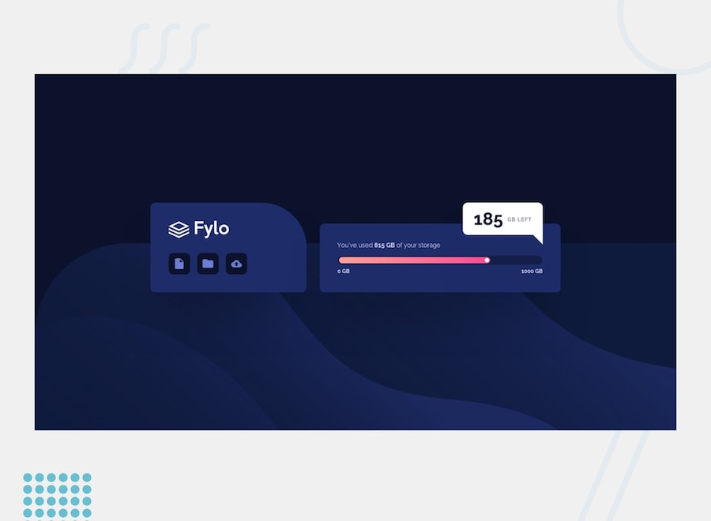

# Frontend Mentor - Fylo data storage component

## Welcome! 👋

Thanks for checking out this front-end coding challenge.

[Frontend Mentor](https://www.frontendmentor.io) challenges help you improve your coding skills by building realistic projects.

# Frontend Mentor - Fylo data storage component solution

This is a solution to the [Fylo data storage component challenge on Frontend Mentor](https://www.frontendmentor.io/challenges/fylo-data-storage-component-1dZPRbV5n). Frontend Mentor challenges help you improve your coding skills by building realistic projects. 

## Table of contents

- [Overview](#overview)
  - [The challenge](#the-challenge)
  - [Screenshot](#screenshot)
  - [Links](#links)
- [My process](#my-process)
  - [Built with](#built-with)
  - [What I learned](#what-i-learned)
  - [Continued development](#continued-development)
  - [Useful resources](#useful-resources)
  - [AI Collaboration](#ai-collaboration)
- [Author](#author)
- [Acknowledgments](#acknowledgments)

## Overview

I completed a Frontend Mentor challenge where I focused on building a responsive website using HTML and CSS. This project helped me strengthen my layout, styling, and problem-solving skills while turning a design into a functional webpage. It also gave me more hands-on experience with front-end development and attention to detail.

### The challenge

Users should be able to:

- View the optimal layout for the site depending on their device's screen size

### Screenshot

### Links

- Live Site URL: (http://127.0.0.1:5500/index.html)
## My process
My development process involved researching solutions to issues I encountered in my code and looking up CSS classes for elements and features I wanted to incorporate. I then referenced the Tailwind CSS documentation to find the appropriate utility classes and understand how to apply them to my design. 

### Built with

- Semantic HTML5 markup
- Flexbox
- Tailwind CSS

### What I learned

Through this challenge, I learned how to use Tailwind CSS utility classes to style and structure a webpage more efficiently. I gained a better understanding of how to apply spacing, sizing, positioning, and colors. I also improved my ability to troubleshoot code, research solutions independently, and use documentation to find the right tools for the job. This experience helped me become more comfortable working with Tailwind CSS and strengthened my problem-solving skills as a developer

I was particularly proud of this section of code because it allowed me to apply knowledge I had previously learned to solve a problem I was struggling with. By experimenting with Tailwind CSS utility classes, I was able to adjust the background image, positioning, sizing, spacing, and overall layout to achieve the result I wanted. It was rewarding to use my existing knowledge to troubleshoot the issue independently and bring my design closer to the intended look.

### Continued development

Moving forward, I plan to continue strengthening my front-end development skills by practicing HTML, CSS, JavaScript, and Tailwind CSS through more challenging projects. I want to improve my ability to recreate designs accurately, write cleaner and more efficient code, and troubleshoot issues independently. I also plan to explore more advanced styling techniques, responsive design, and interactive features while continuing to use documentation and hands-on projects to build my confidence as a developer.

### Useful resources

- (https://tailwindcss.com) - The Tailwind CSS website was one of my most valuable resources throughout this challenge. It helped me identify the correct utility classes for the features I wanted to implement and understand how they worked. Whenever I encountered an issue or wanted to achieve a specific design, I used the documentation to research possible solutions and find the appropriate classes. This allowed me to learn independently, troubleshoot problems, and become more familiar with Tailwind CSS.

### AI Collaboration

I used ChatGPT as a resource throughout the challenge to help troubleshoot coding issues and explore ways to implement specific features into my website. When I wasn't sure how to achieve a particular result, I would describe what I was trying to accomplish or share the code I was having trouble with. ChatGPT helped narrow down my search by suggesting specific Tailwind CSS utility classes that matched what I needed. This made it easier to identify the right classes, understand how they worked, and then reference the official Tailwind CSS documentation for further clarification. It helped streamline my problem-solving process while allowing me to learn along the way.

### Reflection

Throughout this project, one of my biggest challenges was recreating the design as accurately as possible while figuring out which Tailwind CSS utility classes to use. I occasionally ran into issues with spacing, positioning, background images, and sizing. To overcome these challenges, I researched solutions, used ChatGPT to narrow down specific utility classes, and referenced the official Tailwind CSS documentation to understand how they worked. I also applied concepts and techniques previously taught by my instructor, Paul, to troubleshoot problems independently.

If I had more time, I would focus on refining the smaller design details, improving the responsiveness across different screen sizes, and making my code cleaner and more efficient. I would also like to experiment with more advanced Tailwind CSS features to expand my knowledge. Overall, this project helped me become more comfortable with front-end development and more confident in my ability to solve coding problems independently.

## Author

- Website - [Kwame Freeman](http://127.0.0.1:5500/index.html)

## Acknowledgments

A HUGE shout-out to my instructor, Paul! 🎉 Your guidance and encouragement helped me build the skills and confidence to tackle this Frontend Mentor challenge. The concepts you taught me came into play as I worked through coding issues, experimented with Tailwind CSS, and brought my design to life. I truly appreciate everything you've taught me and the foundation you've helped me build as a developer!
